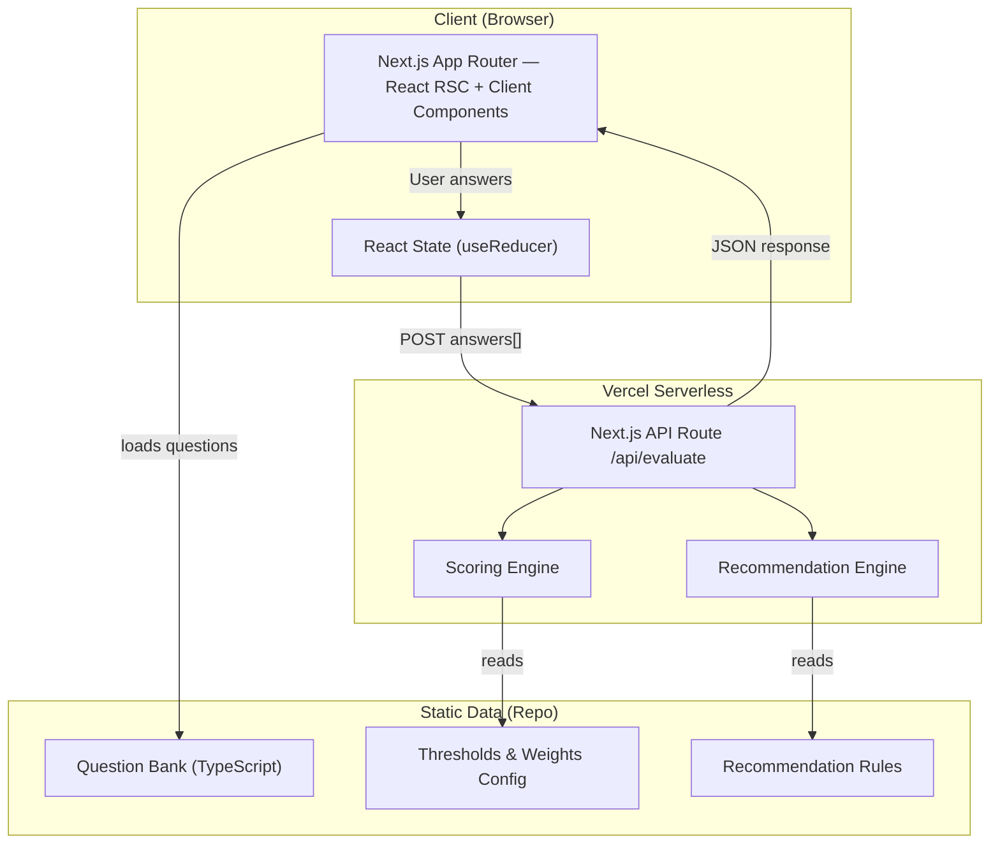
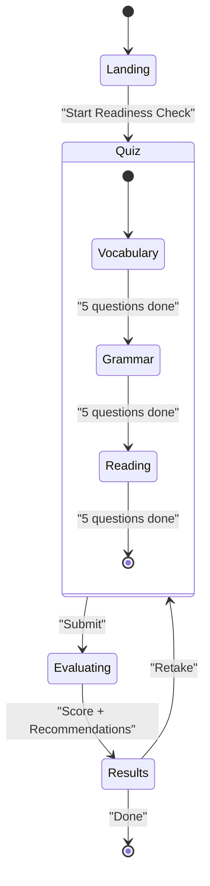
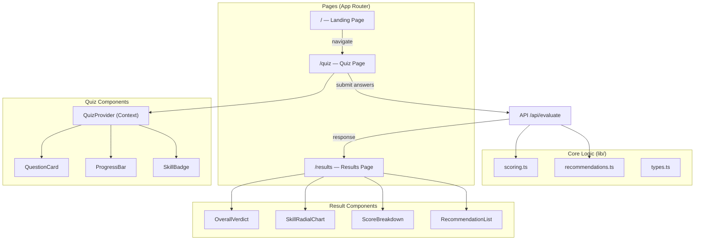
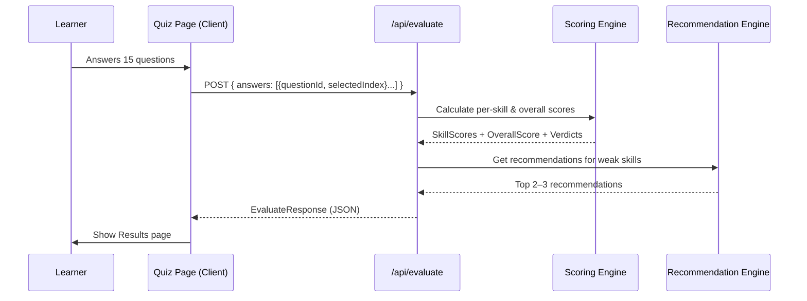

# Architecture — Globio A1 German Exam Readiness Checker

> **Based on:** [problemStatement.md](file:///d:/globio/docs/problemStatement.md)

---

## 1. High-Level Architecture



---

## 2. App Flow & User Journey



### Screen-by-Screen Breakdown

| # | Screen | Route | Description |
|---|--------|-------|-------------|
| 1 | **Landing** | `/` | Hero with CTA "Check Your Exam Readiness", brief explanation of what this check does |
| 2 | **Quiz** | `/quiz` | Guided question flow — one question at a time with progress bar, skill section headers |
| 3 | **Results** | `/results` | Skill-wise readiness scores (radial/bar charts), overall readiness verdict, 2–3 actionable recommendations |

---

## 3. Project Structure

```
globio/
├── docs/
│   ├── problemStatement.md
│   └── architecture.md              ← You are here
│
├── src/
│   ├── app/                          # Next.js App Router
│   │   ├── layout.tsx                # Root layout (fonts, metadata, global providers)
│   │   ├── page.tsx                  # Landing page
│   │   ├── quiz/
│   │   │   └── page.tsx              # Quiz page (client component)
│   │   ├── results/
│   │   │   └── page.tsx              # Results page (client component)
│   │   └── api/
│   │       └── evaluate/
│   │           └── route.ts          # POST — scoring + recommendations API
│   │
│   ├── components/                   # Reusable UI components
│   │   ├── ui/                       # shadcn/ui primitives (Button, Card, Progress, etc.)
│   │   ├── landing/
│   │   │   ├── Hero.tsx
│   │   │   └── FeatureCards.tsx
│   │   ├── quiz/
│   │   │   ├── QuestionCard.tsx       # Renders a single question with options
│   │   │   ├── ProgressBar.tsx        # Shows progress through the quiz
│   │   │   ├── SkillBadge.tsx         # Displays current skill section label
│   │   │   └── QuizProvider.tsx       # Context provider for quiz state
│   │   └── results/
│   │       ├── SkillRadialChart.tsx   # Per-skill readiness radial chart
│   │       ├── OverallVerdict.tsx     # "Ready" / "Almost There" / "Keep Practising"
│   │       ├── RecommendationList.tsx # 2–3 actionable tips
│   │       └── ScoreBreakdown.tsx     # Tabular skill-by-skill breakdown
│   │
│   ├── data/                         # Static question & config data
│   │   ├── questions/
│   │   │   ├── vocabulary.ts          # 5 vocabulary questions
│   │   │   ├── grammar.ts             # 5 grammar questions
│   │   │   └── reading.ts             # 5 reading questions
│   │   ├── thresholds.ts             # Readiness thresholds & weights
│   │   └── recommendations.ts        # Recommendation rules per skill
│   │
│   ├── lib/                          # Core logic (framework-agnostic)
│   │   ├── scoring.ts                # Scoring engine
│   │   ├── recommendations.ts        # Recommendation engine
│   │   └── types.ts                  # Shared TypeScript types & interfaces
│   │
│   └── hooks/                        # Custom React hooks
│       └── useQuiz.ts                # Quiz state machine (useReducer)
│
├── public/                           # Static assets
│   └── globio-logo.svg
│
├── tailwind.config.ts
├── tsconfig.json
├── next.config.ts
├── package.json
└── README.md
```

---

## 4. Data Models

### 4.1 Question

```typescript
type Skill = "vocabulary" | "grammar" | "reading";
type Difficulty = "easy" | "medium" | "hard";

interface Question {
  id: string;                         // e.g., "vocab-01"
  skill: Skill;
  difficulty: Difficulty;
  weight: number;                     // Points if correct (easy=1, medium=2, hard=3)
  prompt: string;                     // The question text (may include a German passage for reading)
  options: string[];                  // 4 multiple-choice options
  correctIndex: number;               // Index of the correct option (0–3)
  explanation: string;                // Shown in results — why this answer is correct
}
```

### 4.2 Quiz State

```typescript
interface QuizState {
  currentIndex: number;               // Which question the user is on (0–14)
  answers: Map<string, number>;       // questionId → selected option index
  startedAt: number;                  // Timestamp for optional time tracking
  status: "not_started" | "in_progress" | "submitted";
}
```

### 4.3 Evaluation Request / Response

```typescript
// POST /api/evaluate — Request body
interface EvaluateRequest {
  answers: { questionId: string; selectedIndex: number }[];
}

// POST /api/evaluate — Response body
interface EvaluateResponse {
  overall: {
    score: number;                    // 0–100
    maxScore: number;                 // Maximum possible (sum of all weights)
    verdict: "ready" | "almost" | "not_ready";
  };
  skills: {
    skill: Skill;
    score: number;                    // 0–100 for this skill
    correct: number;                  // Questions answered correctly
    total: number;                    // Total questions in this skill
    verdict: "strong" | "needs_work" | "weak";
  }[];
  recommendations: {
    priority: number;                 // 1 = most important
    skill: Skill;
    title: string;                    // e.g., "Strengthen your noun genders"
    description: string;              // Actionable advice
  }[];
  questionResults: {
    questionId: string;
    correct: boolean;
    explanation: string;
  }[];
}
```

---

## 5. Scoring Engine

### 5.1 Weighted Scoring

Each question has a **weight** based on difficulty:

| Difficulty | Weight | Rationale |
|-----------|--------|-----------|
| Easy | 1 | Fundamental A1 knowledge — must-know |
| Medium | 2 | Standard exam-level competency |
| Hard | 3 | Near the upper boundary of A1 |

**Per-skill score** (0–100):

$$
\text{SkillScore} = \frac{\sum \text{weight}_i \times \text{correct}_i}{\sum \text{weight}_i} \times 100
$$

Where $\text{correct}_i$ is 1 if the answer is correct, 0 otherwise.

**Overall score** (0–100):

$$
\text{OverallScore} = \frac{\text{VocabScore} + \text{GrammarScore} + \text{ReadingScore}}{3}
$$

Equal weighting across skills — all three matter equally for A1 readiness.

### 5.2 Readiness Thresholds

| Overall Score | Verdict | Label |
|--------------|---------|-------|
| ≥ 80% | `ready` | ✅ Ready to book |
| 60–79% | `almost` | ⚠️ Almost there |
| < 60% | `not_ready` | 🔴 Keep practising |

| Skill Score | Verdict | Meaning |
|------------|---------|---------|
| ≥ 80% | `strong` | No action needed |
| 50–79% | `needs_work` | Should review this area |
| < 50% | `weak` | Priority focus area |

> [!IMPORTANT]
> These thresholds are configurable in `src/data/thresholds.ts`. They can be tuned based on real learner data or Globio's exam pass-rate insights.

---

## 6. Recommendation Engine

### 6.1 Logic

1. **Rank skills** by score (ascending — weakest first).
2. **Filter** to skills with verdict `weak` or `needs_work`.
3. **Pick top 2–3** weakest skills.
4. **Map** each to a pre-written, actionable recommendation from the rules table.

### 6.2 Recommendation Rules

```typescript
// src/data/recommendations.ts

const recommendations: Record<Skill, Record<"weak" | "needs_work", Recommendation>> = {
  vocabulary: {
    weak: {
      title: "Build your core A1 vocabulary",
      description: "Focus on the 500 most common German words. Use flashcards daily covering topics: family, food, travel, work, and daily routines. Practise with Globio's vocabulary modules."
    },
    needs_work: {
      title: "Sharpen tricky vocabulary",
      description: "You know the basics, but watch out for false friends and compound nouns. Review word genders (der/die/das) — they appear in every exam section."
    }
  },
  grammar: {
    weak: {
      title: "Master A1 grammar fundamentals",
      description: "Focus on: present tense conjugation, Akkusativ vs. Nominativ, word order (Verb-Second), and separable verbs. These are tested heavily in the Goethe A1 exam."
    },
    needs_work: {
      title: "Tighten your grammar accuracy",
      description: "Review Perfekt tense (haben/sein + Partizip II), prepositions with cases, and modal verbs. Try rewriting short sentences to build muscle memory."
    }
  },
  reading: {
    weak: {
      title: "Practise reading short German texts",
      description: "Start with simple notices, emails, and signs — the kind you'll see on the exam. Read slowly, underline key words, and practise extracting who/what/when/where."
    },
    needs_work: {
      title: "Improve reading speed and accuracy",
      description: "You can read German, but practise under timed conditions. Focus on skimming for specific information — the exam rewards finding answers quickly, not reading every word."
    }
  }
};
```

### 6.3 Example Output

For a learner who scored: Vocabulary 85%, Grammar 45%, Reading 62%:

| # | Recommendation | Skill |
|---|---------------|-------|
| 1 | 🔴 Master A1 grammar fundamentals | Grammar (weak) |
| 2 | ⚠️ Improve reading speed and accuracy | Reading (needs_work) |

---

## 7. Question Design

### 7.1 Distribution

| Skill | Questions | Difficulty Spread | Max Weighted Score |
|-------|----------|-------------------|--------------------|
| **Vocabulary** | 5 | 2 easy, 2 medium, 1 hard | 1+1+2+2+3 = **9** |
| **Grammar** | 5 | 2 easy, 2 medium, 1 hard | **9** |
| **Reading** | 5 | 1 easy, 2 medium, 2 hard | 1+2+2+3+3 = **11** |
| **Total** | **15** | | **29** |

> [!NOTE]
> Reading has a slightly harder spread because reading comprehension is a composite skill — it implicitly tests vocabulary and grammar too.

### 7.2 Question Format

All questions are **multiple-choice with 4 options** — matching the Goethe/ÖSD A1 exam format.

| Skill | Question Style |
|-------|---------------|
| **Vocabulary** | "What does _Entschuldigung_ mean?" / "Choose the correct word to complete: Ich trinke gerne ___." |
| **Grammar** | "Choose the correct form: Er ___ (gehen) jeden Tag zur Schule." / "Which sentence is grammatically correct?" |
| **Reading** | Short passage (3–5 sentences: email, sign, notice) followed by a comprehension question |

---

## 8. Component Architecture



### Key Component Responsibilities

| Component | Type | Responsibility |
|-----------|------|----------------|
| `QuizProvider` | Client | Manages quiz state via `useReducer`; provides `currentQuestion`, `selectAnswer`, `nextQuestion`, `submit` |
| `QuestionCard` | Client | Renders prompt, 4 options (radio buttons), highlights selected answer |
| `ProgressBar` | Client | Shows `currentIndex / totalQuestions` with skill section markers |
| `SkillBadge` | Client | Shows which skill section the user is in (Vocabulary → Grammar → Reading) |
| `OverallVerdict` | Client | Large verdict display: ✅ Ready / ⚠️ Almost / 🔴 Keep Practising |
| `SkillRadialChart` | Client | Three radial progress charts — one per skill, color-coded by verdict |
| `ScoreBreakdown` | Client | Tabular view: skill, score %, correct/total, verdict badge |
| `RecommendationList` | Client | Ordered list of 2–3 cards with priority, title, and description |

---

## 9. API Design

### `POST /api/evaluate`

The only API endpoint. Receives answers, runs scoring + recommendations server-side, returns the full result.

| Aspect | Detail |
|--------|--------|
| **Method** | `POST` |
| **Route** | `/api/evaluate` |
| **Request** | `EvaluateRequest` — array of `{ questionId, selectedIndex }` |
| **Response** | `EvaluateResponse` — overall score, per-skill scores, verdict, recommendations, per-question results |
| **Why server-side?** | Keeps correct answers out of the client bundle. The question bank is loaded at build time for rendering, but `correctIndex` is only used server-side. |

> [!CAUTION]
> The question data served to the client must **exclude `correctIndex` and `explanation`**. These fields are only used in the API route to prevent learners from inspecting the browser's JS bundle to find answers.

### Client-Server Data Flow



---

## 10. Styling & UI/UX Decisions

### Design Principles

| Principle | Implementation |
|-----------|---------------|
| **Clean & focused** | Minimal distractions — one question visible at a time, no sidebar clutter |
| **Mobile-first** | Responsive design; many learners will use phones |
| **Progress visibility** | Always-visible progress bar with skill section markers |
| **Encouraging tone** | Results use positive framing ("Almost there!" vs. "You failed") |
| **Globio-aligned** | Use Globio's brand colors and tone where possible |

### shadcn/ui Components to Use

| Component | Used For |
|-----------|---------|
| `Card` | Question cards, recommendation cards, score cards |
| `Button` | Navigation, CTA, option selection |
| `Progress` | Quiz progress bar |
| `Badge` | Skill labels, verdict tags |
| `RadioGroup` | Answer selection |
| `Separator` | Section dividers |

---

## 11. Performance & Security

| Concern | Approach |
|---------|----------|
| **Bundle size** | Static question prompts loaded at build time; no runtime DB calls |
| **Answer security** | `correctIndex` stripped from client bundle — only available in server-side API route |
| **Rate limiting** | Not needed at this scale; Vercel provides basic DDoS protection on free tier |
| **Accessibility** | shadcn/ui components are ARIA-compliant; keyboard-navigable quiz |
| **SEO** | Landing page is a Server Component (SSR); quiz/results are client-side |
| **Cold start** | Vercel serverless has ~100ms cold start — acceptable for a single API call after quiz |

---

## 12. Future Enhancements (Out of Scope)

| Enhancement | Description |
|-------------|-------------|
| **Gemini AI recommendations** | Replace static recommendation rules with Gemini API for personalised, context-aware tips |
| **Question bank rotation** | Larger question pool with random selection per session |
| **Listening skill** | Add audio-based questions (Hören) to cover all 4 Goethe exam sections |
| **Writing skill** | Free-text short writing prompt with AI grading |
| **User accounts** | Track progress over multiple attempts |
| **Analytics dashboard** | Aggregate learner data to identify common weak areas |
| **Multilingual UI** | Support Hindi/English toggle for instructions (questions stay in German) |

