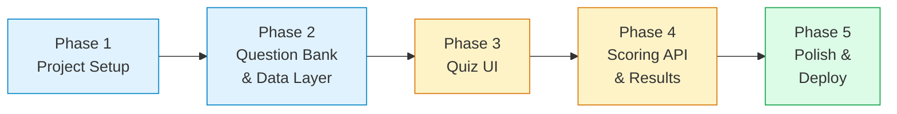
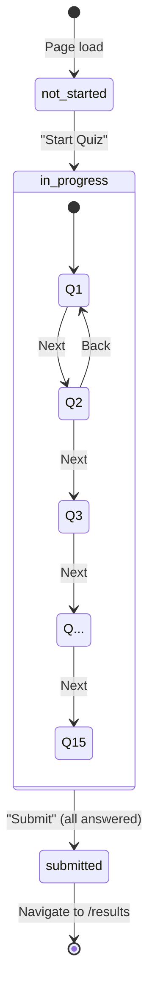
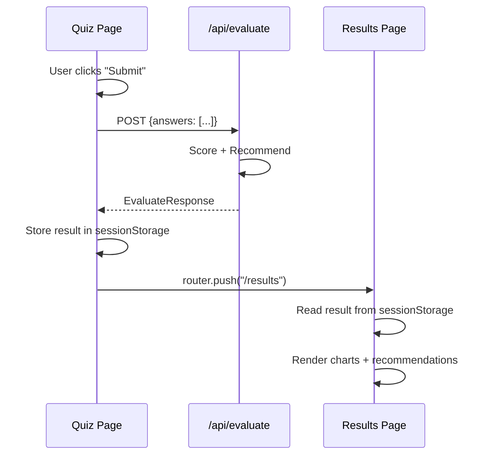
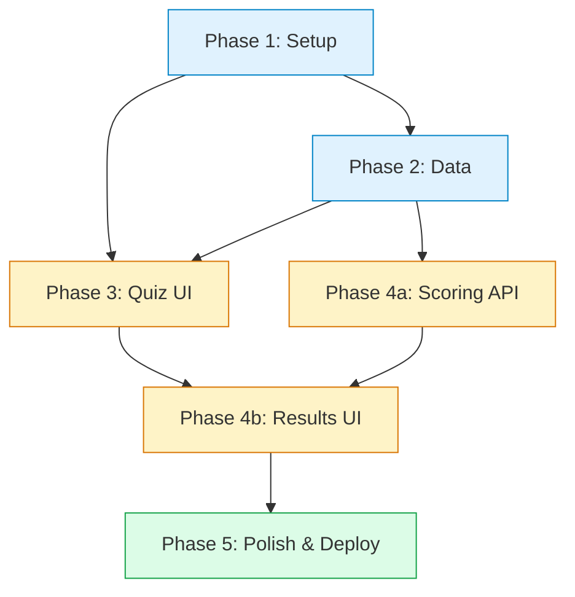

# Implementation Plan — Globio A1 German Exam Readiness Checker

> **Based on:** [architecture.md](file:///d:/globio/docs/architecture.md) · [problemStatement.md](file:///d:/globio/docs/problemStatement.md)

---

## Overview

| Item | Detail |
|------|--------|
| **Total Phases** | 5 |
| **Estimated Time** | ~8–10 hours of focused work |
| **Approach** | Phase-wise — each phase produces a working, testable increment |
| **Stack** | Next.js 15 (App Router) · TypeScript · Tailwind CSS · shadcn/ui · Vercel |

---

## Phase 1 — Project Scaffolding & Setup

**Goal:** A running Next.js app with Tailwind + shadcn/ui, pushed to GitHub, deployable on Vercel.

**Estimated Time:** ~1 hour

### Tasks

| # | Task | File(s) | Done |
|---|------|---------|------|
| 1.1 | Initialize Next.js project with TypeScript + App Router | `package.json`, `tsconfig.json`, `next.config.ts` | [x] |
| 1.2 | Install and configure Tailwind CSS | `globals.css` | [x] |
| 1.3 | Initialize shadcn/ui and install base components: `Button`, `Card`, `Badge`, `Progress`, `RadioGroup`, `Separator` | `src/components/ui/*` | [x] |
| 1.4 | Set up project folder structure per architecture doc | `src/app/`, `src/components/`, `src/data/`, `src/lib/`, `src/hooks/` | [x] |
| 1.5 | Create root layout with metadata, fonts, and global styles | `src/app/layout.tsx` | [x] |
| 1.6 | Add placeholder pages for all three routes and API handler | `src/app/page.tsx`, `src/app/quiz/page.tsx`, `src/app/results/page.tsx`, `src/app/api/evaluate/route.ts` | [x] |
| 1.7 | Initialize Git repo, create `.gitignore`, make clean initial commit | `.gitignore`, `README.md` | [x] |
| 1.8 | Connect repo to GitHub & Vercel | Vercel / GitHub | [x] (GitHub: Anaagh05/globio-a1-readiness-check) |

### Exit Criteria

- [x] `pnpm dev` runs without errors
- [x] All three routes (`/`, `/quiz`, `/results`) render placeholder content
- [x] App is live on a Vercel URL
- [x] Code is on GitHub

> [!TIP]
> Do this phase first and deploy immediately. Having a live URL from the start means every subsequent phase can be verified on the real deployment, not just localhost.

---

## Phase 2 — Question Bank & Data Layer

**Goal:** 15 curated A1 German questions stored as typed data, plus scoring thresholds and recommendation rules — all ready for the UI and API to consume.

**Estimated Time:** ~1.5–2 hours

### Tasks

| # | Task | File(s) | Done |
|---|------|---------|------|
| 2.1 | Define core TypeScript types: `Skill`, `Difficulty`, `Question`, `QuizState`, `EvaluateRequest`, `EvaluateResponse` | `src/lib/types.ts` | [x] |
| 2.2 | Write 5 vocabulary questions (2 easy, 2 medium, 1 hard) | `src/data/questions/vocabulary.ts` | [x] |
| 2.3 | Write 5 grammar questions (2 easy, 2 medium, 1 hard) | `src/data/questions/grammar.ts` | [x] |
| 2.4 | Write 5 reading questions with short passages (1 easy, 2 medium, 2 hard) | `src/data/questions/reading.ts` | [x] |
| 2.5 | Create a combined question index that exports all 15 questions in order | `src/data/questions/index.ts` | [x] |
| 2.6 | Create a client-safe question export that strips `correctIndex` and `explanation` | `src/data/questions/client.ts` | [x] |
| 2.7 | Define readiness thresholds config (overall + per-skill) | `src/data/thresholds.ts` | [x] |
| 2.8 | Define recommendation rules (per skill × weak / needs_work) | `src/data/recommendations.ts` | [x] |

### Question Quality Guidelines

> [!IMPORTANT]
> Questions must reflect **real Goethe/ÖSD A1 exam patterns**:
> - Vocabulary: common A1 word lists (Wortschatz A1 from Goethe-Institut)
> - Grammar: present tense, Perfekt, Akkusativ/Nominativ, word order, modal verbs
> - Reading: short emails, signs, notices, announcements (3–5 sentences)
> - All options must be plausible — no joke answers
> - Each question needs a clear, educational `explanation`

### Exit Criteria

- [x] 15 questions pass type-checking (`Skill`, `Difficulty`, weighted correctly)
- [x] Client-safe export contains no `correctIndex` or `explanation` fields
- [x] Thresholds and recommendation rules are defined and importable

---

## Phase 3 — Quiz UI

**Goal:** A fully interactive quiz flow — landing page → guided question-by-question experience → submit.

**Estimated Time:** ~2.5–3 hours

### Tasks

| # | Task | File(s) | Done |
|---|------|---------|------|
| 3.1 | Build the **Landing Page** — hero section, CTA button, brief feature explanation | `src/app/page.tsx`, `src/components/landing/Hero.tsx`, `src/components/landing/FeatureCards.tsx` | [x] |
| 3.2 | Implement `useQuiz` hook — `useReducer` state machine managing `currentIndex`, `answers`, `status` | `src/hooks/useQuiz.ts` | [x] |
| 3.3 | Build `QuizProvider` — React context wrapping `useQuiz`, provides state + actions to children | `src/components/quiz/QuizProvider.tsx` | [x] |
| 3.4 | Build `QuestionCard` — renders prompt, 4 options via `RadioGroup`, highlights selected | `src/components/quiz/QuestionCard.tsx` | [x] |
| 3.5 | Build `ProgressBar` — shows question progress with skill section markers (Vocab → Grammar → Reading) | `src/components/quiz/ProgressBar.tsx` | [x] |
| 3.6 | Build `SkillBadge` — displays which skill section the learner is in | `src/components/quiz/SkillBadge.tsx` | [x] |
| 3.7 | Assemble the **Quiz Page** — combines all quiz components, handles navigation (Next / Back / Submit) | `src/app/quiz/page.tsx` | [x] |
| 3.8 | Add page transitions / animations (optional — subtle fade between questions) | Quiz components | [x] |
| 3.9 | Mobile responsiveness pass — test quiz flow on small screens | All quiz components | [x] |

### UI State Machine

### Exit Criteria

- [x] Landing page renders with working CTA → navigates to `/quiz`
- [x] Quiz displays questions one at a time with progress bar
- [x] User can select an answer, navigate forward/back, and see skill transitions
- [x] Submit button is enabled only when all 15 questions are answered
- [x] Quiz state is preserved during navigation (answers aren't lost on Back)
- [x] Works on mobile (320px+) and desktop

---

## Phase 4 — Scoring API & Results Page

**Goal:** Server-side evaluation endpoint + a visually rich results page showing skill-wise scores, verdict, and recommendations.

**Estimated Time:** ~2.5–3 hours

### Tasks

| # | Task | File(s) | Done |
|---|------|---------|------|
| **API** | | | |
| 4.1 | Implement `calculateSkillScores()` — weighted scoring per skill | `src/lib/scoring.ts` | [x] |
| 4.2 | Implement `calculateOverallScore()` — average of skill scores, map to verdict | `src/lib/scoring.ts` | [x] |
| 4.3 | Implement `generateRecommendations()` — rank weak skills, return top 2–3 recommendations | `src/lib/recommendations.ts` | [x] |
| 4.4 | Build `POST /api/evaluate` route — validate request, run scoring + recommendations, return `EvaluateResponse` | `src/app/api/evaluate/route.ts` | [x] |
| 4.5 | Add input validation — reject malformed requests, wrong question counts, out-of-range indices | `src/app/api/evaluate/route.ts` | [x] |
| **Results UI** | | | |
| 4.6 | Build `OverallVerdict` — large display: ✅ Ready / ⚠️ Almost There / 🔴 Keep Practising | `src/components/results/OverallVerdict.tsx` | [x] |
| 4.7 | Build `SkillRadialChart` — three radial/circular progress charts, color-coded by verdict | `src/components/results/SkillRadialChart.tsx` | [x] |
| 4.8 | Build `ScoreBreakdown` — tabular view: skill, score %, correct/total, verdict badge | `src/components/results/ScoreBreakdown.tsx` | [x] |
| 4.9 | Build `RecommendationList` — ordered cards with priority number, title, description | `src/components/results/RecommendationList.tsx` | [x] |
| 4.10 | Assemble **Results Page** — calls API on mount, displays loading state, then all result components | `src/app/results/page.tsx` | [x] |
| 4.11 | Add "Retake" button — resets quiz state and navigates back to `/quiz` | `src/app/results/page.tsx` | [x] |
| **Integration** | | | |
| 4.12 | Wire Quiz submit → API call → Results page (pass data via URL state, sessionStorage, or React context) | `src/app/quiz/page.tsx`, `src/app/results/page.tsx` | [x] |

### Data Flow on Submit

### Exit Criteria

- [x] `POST /api/evaluate` returns correct scores for a known set of answers (manual test)
- [x] Scores are mathematically correct (weighted formula matches architecture doc)
- [x] Results page shows overall verdict, 3 skill charts, score breakdown table, and 2–3 recommendations
- [x] "Retake" button works — returns to a fresh quiz
- [x] Loading / error states are handled gracefully

---

## Phase 5 — Polish, Test & Deploy

**Goal:** Production-quality finish — visual polish, edge cases, accessibility, final deploy.

**Estimated Time:** ~1–1.5 hours

### Tasks

| # | Task | File(s) | Done |
|---|------|---------|------|
| **Visual Polish** | | | |
| 5.1 | Refine color palette — align with Globio's brand (emerald / OKLCH theme) | `tailwind.config.ts`, `globals.css` | [x] |
| 5.2 | Add Globio logo and brand styling to header & landing | `src/app/page.tsx`, `src/app/layout.tsx` | [x] |
| 5.3 | Add smooth transitions between quiz questions | Quiz components | [x] |
| 5.4 | Add favicon, keywords, and Open Graph meta tags | `src/app/layout.tsx` | [x] |
| **Edge Cases** | | | |
| 5.5 | Handle direct navigation to `/results` without quiz data | `src/app/results/page.tsx` | [x] |
| 5.6 | Handle direct navigation to `/quiz` — fresh quiz start | `src/app/quiz/page.tsx` | [x] |
| 5.7 | Prevent accidental page close during quiz (beforeunload) | `src/components/quiz/QuizRunner.tsx` | [x] |
| **Accessibility** | | | |
| 5.8 | Keyboard navigation — 1–4, A–D to select, Enter to proceed | `src/components/quiz/QuizRunner.tsx` | [x] |
| 5.9 | Screen reader labels — ARIA on progress bar, radio items, SVGs | All components | [x] |
| 5.10 | Focus & touch targets (min 52px height) | `QuestionCard.tsx` | [x] |
| **Testing** | | | |
| 5.11 | Diagnostic verification across all 3 verdict paths | `src/lib/scoring.ts`, `scripts/` | [x] |
| 5.12 | Mobile responsiveness pass (320px–desktop) | All quiz components | [x] |
| 5.13 | Verify zero correct answers or explanations in client bundle | `.next/static` bundle audit | [x] |
| **Deploy** | | | |
| 5.14 | Final push to GitHub repository | GitHub `main` branch | [x] |
| 5.15 | Production build verification | Turbopack `npm run build` | [x] |
| 5.16 | Update `README.md` with complete documentation & guides | `README.md` | [x] |

### Exit Criteria

- [x] App looks polished on mobile and desktop
- [x] All 3 verdict paths work (ready / almost / not_ready)
- [x] No console errors or warnings
- [x] `correctIndex` not visible in client bundle
- [x] Production build passes with zero errors
- [x] README has live GitHub link + setup & deploy instructions
- [x] GitHub repo is public and clean

---

## Phase Summary

| Phase | Focus | Key Output | Est. Time |
|-------|-------|-----------|-----------|
| **1** | Setup | Running app on Vercel + GitHub | ~1h |
| **2** | Data | 15 typed questions + scoring config | ~1.5–2h |
| **3** | Quiz UI | Interactive question flow with progress | ~2.5–3h |
| **4** | Scoring + Results | API endpoint + rich results page | ~2.5–3h |
| **5** | Polish + Deploy | Production-ready, accessible, deployed | ~1–1.5h |
| | | **Total** | **~8–10h** |

> [!IMPORTANT]
> **Deploy after every phase, not just at the end.** Each phase should result in a working Vercel deploy. This catches build/deploy issues early and gives you a shareable link at every stage.

---

## Dependency Graph

> Phase 2 (Data) and Phase 3 (Quiz UI) can be worked on in **parallel** after Phase 1 is done — they only converge when the quiz needs to load real questions. Phase 4 splits naturally into API (4a) and UI (4b), where 4b depends on 4a being functional.

