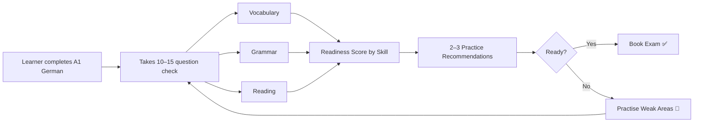

# Problem Statement — Globio A1 German Exam Readiness Checker

> **Source:** [problemStatement](file:///d:/globio/problemStatement)
> **Website:** [globio.ai](https://www.globio.ai/)

---

## About Globio

Globio is an **edtech and workforce mobility platform** that helps individuals — primarily from India — learn German and navigate the career and immigration pathways to move to Germany.

| Aspect | Details |
|--------|---------|
| **Courses** | Structured German courses from **A1 to B2**, aligned to **Goethe-Zertifikat** and **telc** exam standards |
| **Learning Format** | Blended: 100+ hours of self-paced video per level + live weekend speaking classes |
| **AI Tools** | AI-powered speaking drills, grammar coaching, 24/7 conversational practice, automated AI scoring for writing & speaking mock tests |
| **Mock Tests** | Full Goethe & telc format mocks (Lesen, Hören, Schreiben, Sprechen) with instant grading and explanations |
| **Exam Guarantee** | Exam pass guarantee — refund/support if the learner completes the course but fails the official exam |
| **Beyond Language** | End-to-end Germany pathways: Ausbildung, Chancenkarte (Opportunity Card), university admissions, visa support, dedicated case management |

---

## The Problem

> *"This is a real problem we care about, and we want to see how you would solve it."*

Many of Globio's learners finish **A1 German** and book their **Goethe** or **ÖSD** exam without knowing if they are ready. Some fail and lose both their **exam fee** and **precious time** on their journey abroad.

### Core Pain Points

| # | Pain Point | Impact |
|---|-----------|--------|
| 1 | No pre-exam self-assessment tool | Learners book exams blindly, without gauging their readiness |
| 2 | Exam failure wastes money | Lost exam fees (Goethe/ÖSD fees are non-trivial) |
| 3 | Exam failure wastes time | Delays visa/immigration timelines and the journey to Germany |

> [!NOTE]
> Globio already offers full-length Goethe & telc mock tests on their platform. This challenge asks for something different — a **short, focused readiness check** (not a full mock exam) that gives learners a quick signal on whether they should book the exam or keep practising.

---

## Part 1: Build

### Objective

Build a small **web app** where a learner takes a short readiness check of **10–15 questions** across three skill areas:

| Skill Area | Description |
|-----------|-------------|
| **Vocabulary** | A1-level word knowledge and usage |
| **Grammar** | A1 German grammar rules and sentence structure |
| **Reading** | Comprehension of short A1-level German texts |

### Post-Check Output

After completing the check, the app should tell the learner:

1. **Readiness Score** — How ready they are, **broken down by skill** (Vocabulary, Grammar, Reading).
2. **Actionable Recommendations** — The **2–3 things** they should practise before booking the exam.

### Key Design Decisions (Open)

- **"Ready" calculation** — We decide how readiness is defined and scored.
- **Tech stack** — Any tech stack or tools are fine. *(See chosen stack below.)*

### Deliverables

- [ ] Hosted app on a **public link** (Vercel)
- [ ] Source code shared on **GitHub**

---

## Tech Stack (All Free)

| Layer | Tool | Purpose |
|-------|------|---------|
| **Framework** | [Next.js 15](https://nextjs.org/) (App Router) | Full-stack React framework — handles UI + API routes in one project |
| **Styling** | [Tailwind CSS](https://tailwindcss.com/) + [shadcn/ui](https://ui.shadcn.com/) | Utility-first CSS + polished, accessible component library (cards, progress bars, charts) |
| **Language** | TypeScript | Type safety and better developer experience |
| **Question Data** | JSON / TypeScript files | 10–15 questions don't need a database — static data stored in the repo |
| **Hosting** | [Vercel](https://vercel.com/) (free tier) | Zero-config Next.js hosting, automatic deploys from GitHub, instant public URL |
| **Source Control** | [GitHub](https://github.com/) | Free public repository — also a required deliverable |
| **AI (optional)** | [Gemini API](https://ai.google.dev/) (free tier) | Could power personalised practice recommendations; generous free-tier limits |

> [!TIP]
> This stack is entirely free for this scale of app. Vercel's free tier includes custom domains, automatic HTTPS, preview deploys on every PR, and serverless functions — more than enough for a quiz app.

---

## Summary

